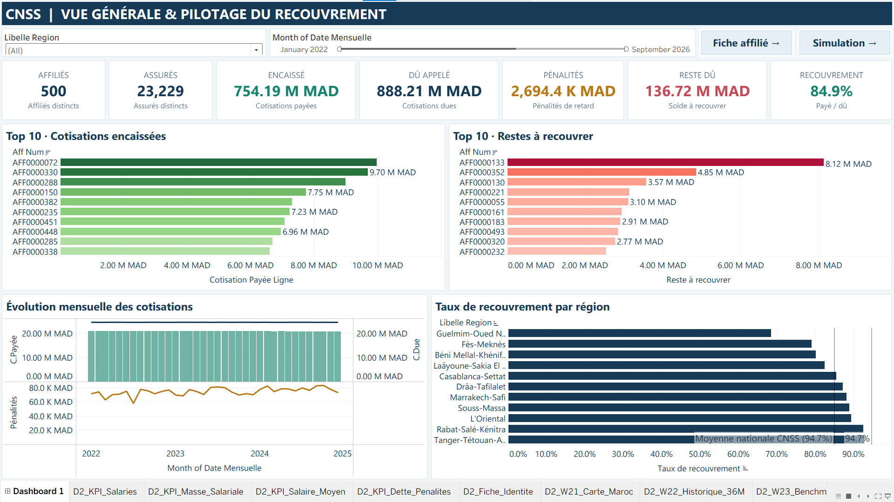
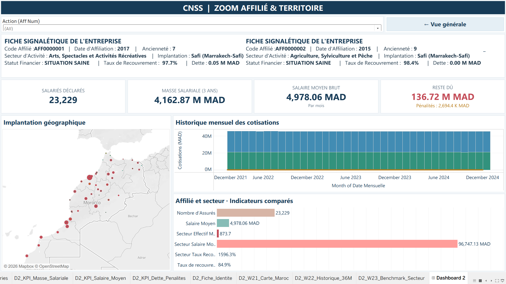
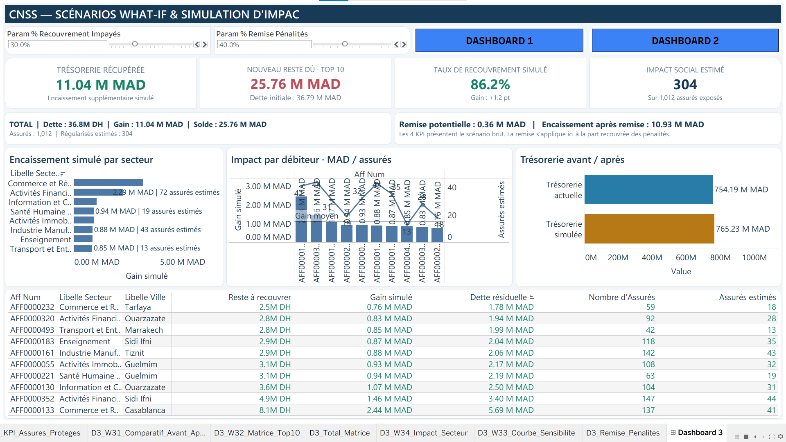

# CNSS Contributions & Payroll - Business Intelligence Dashboard

A Tableau portfolio project that turns simulated employer contributions and payroll declarations into interactive reporting and what-if collection scenarios.

**Author:** Yassine Khadir  
**Internship:** CNSS, Casablanca, September 2026  
**Tools used during the project:** Talend Open Studio, Oracle SQL, Tableau Public and datasets generated with Python.

> This is an educational internship project built on synthetic data. It is not an official CNSS publication, a production system, or a source of actual employer, employee or collection statistics.



## What the project demonstrates

- Integration of operational-style data into an analytical workflow.
- Separation of contribution facts (employer/month) and payroll facts (employer/insured identifier/month).
- KPI calculations, geographical and sector comparisons, and employer-level exploration.
- Three Tableau dashboards: portfolio overview, employer analysis and collection scenarios.
- Data checks for keys, completeness, references and financial aggregations.

## Dataset

The delivered CSV files cover **January 2022 to December 2024**, not the internship year.

| File | Rows | Grain |
| --- | ---: | --- |
| `tableau_aff.csv` | 500 | One affiliated employer |
| `tableau_cal.csv` | 36 | One calendar month |
| `tableau_payment.csv` | 18,000 | One employer and month |
| `tableau_salaires.csv` | 836,244 | One employer, insured identifier and month |

There are 23,229 distinct synthetic insured identifiers. They are dataset identifiers, not actual social security records. See [data dictionary](docs/data-dictionary.md) and the reproducible [validation results](docs/validation.json).

## Dashboard tour

### 1. Portfolio overview

Contributions due and paid, penalties, net outstanding amounts, collection ratio, top employers and regional trends.

### 2. Employer and territory analysis

Employer profile, workforce and payroll indicators, geographical view, contribution history and sector comparisons.



### 3. Collection scenarios

Parameters explore hypothetical recovery of outstanding balances and partial penalty waivers. Outputs are conditional arithmetic estimates, not validated forecasts or evidence of changes to insured persons' benefits.



Screenshots are extracted from the original internship report. They show the original prototype and its current filter/parameter states. See [known limitations](docs/limitations.md) before interpreting individual labels or ratios.

## Open the workbook

1. Download the repository as a ZIP from GitHub and extract it. GitHub does not render Tableau workbooks interactively.
2. Open `tableau/cnss_dashboard.twbx` in a Tableau application that supports packaged workbooks. The workbook was saved with Tableau **2026.2.2**; use that version or a compatible newer version.
3. The packaged workbook contains its Hyper extract. If Tableau requests source CSV files or you want to refresh the data, browse to the corresponding files in `data/`.
4. Explore the three dashboard tabs, filters, navigation actions and scenario parameters.

The `.twb` file is also included for inspection of worksheet definitions, calculations and data relationships. It is a companion source file; open the `.twbx` for the included extract.

## Reproduce the data checks

With Python 3 installed, run from the repository root:

```sh
python scripts/validate_data.py
```

No additional Python packages are needed. The script reads the four CSV files and writes `docs/validation.json`. It validates the CSV deliverables, not every Tableau filter, SQL constraint or original ETL execution.

## Original workflow and included deliverables


My contribution covered Talend integration, Oracle storage, analytical modelling and Tableau reporting. The data-generation script was supplied by my internship supervisor.

This repository includes the Tableau workbook, delivered CSV datasets, report screenshots and portfolio documentation. The original Python generator, Talend job exports and Oracle SQL source scripts were **not present in the supplied project folder** and are not included. The original ETL workflow cannot be recreated end to end from this repository alone.

## Financial definitions

- **Due:** `DEBIT_CNSS + DEBIT_AMO + DEBIT_TFP`
- **Paid:** `CREDIT_CNSS + CREDIT_TFP`
- **Penalties:** `PN_CNSS + PN_TFP`
- **Net outstanding:** due + penalties - paid
- **Collection ratio:** total paid / total due

The source has no separate `CREDIT_AMO` field. These definitions describe this workbook's synthetic model; they are not a complete representation of actual CNSS accounting rules.

## Repository structure

```text
tableau/                 Packaged workbook and readable Tableau XML
data/                    Four synthetic CSV datasets
docs/images/             Three original dashboard screenshots
docs/data-dictionary.md  Dataset fields and analytical grain
docs/limitations.md      Prototype and interpretation limits
docs/validation.json     Reproducible CSV audit results
scripts/validate_data.py Data validation script
```

## Author

[Yassine Khadir on LinkedIn](https://www.linkedin.com/in/yassine-khadir/) - Econometrics & Applied Data Science.

No open-source license has been assigned to the original internship assets. Public visibility does not itself grant a reuse license. CNSS names identify the internship context and do not imply institutional endorsement.
